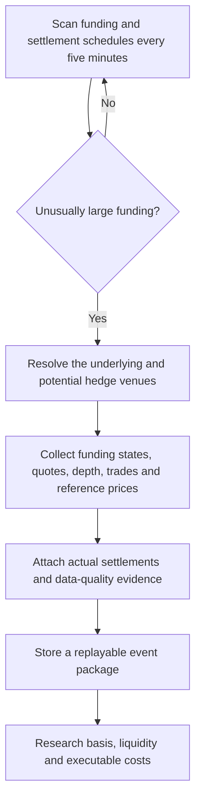
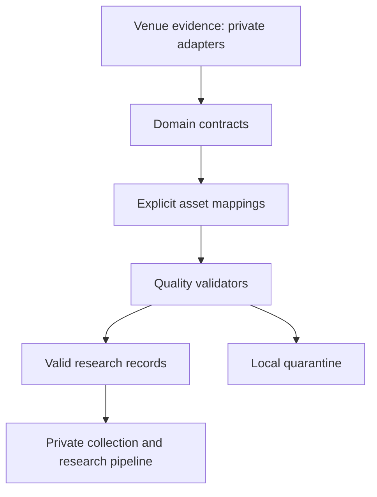

# Multi-Venue Funding Research

**Event-driven research data for perpetual futures funding and hedging across Binance, Bybit, OKX, and Hyperliquid.**

I started this project to investigate funding-rate arbitrage. A large funding rate is not necessarily a viable trade: the hedge might be unavailable, the price difference between venues can move against the position, and execution and capital costs can exceed the funding payment. I built a research data system to study those questions using observations around actual funding events.

> **Status:** Data collection and validation implemented; economic-feasibility research in progress. This is not a profitable-trading claim or a live execution bot.

## How it works



The collection trigger is a **research-data admission rule**, not a signal that a trade should be executed.

## Development-system features (mostly excluded from this excerpt)

- Five-minute scans of perpetual-futures funding and settlement schedules across four venues.
- Event-driven detailed collection when absolute funding crosses the configured admission threshold; the currently documented threshold is **0.10% per settlement**.
- Discovery and observation of supported same-underlying hedge instruments at other venues, instead of examining the high-funding contract alone.
- Best bid/ask quotes, public trades, reference prices, and bounded order-book depth around settlement windows. Source-specific depth evidence is not assumed to be perfectly comparable across all venues.
- Venue-specific instrument and contract-unit mapping, with unverified mappings kept separate from eligible canonical pairings.
- Separation of indicative funding information from actual realized funding payments.
- Data-quality checks for stale observations, gaps, timestamp alignment, source provenance, and replay/integrity.
- A local research inventory over preserved event evidence.

### Why the details matter

**Contract identity:** The same ticker does not automatically mean the same economic exposure across exchanges. For example, a `1000BTT` contract requires explicit unit conversion before it can be compared with other BTT products.

**Funding vs. basis:** A favorable funding differential can be offset by changes in the cross-venue basis or by the cost of entering and unwinding both legs.

**Tradable liquidity:** The displayed best price is not enough to determine fill quality at larger sizes. Depth, spread, slippage, and partial-fill risks remain part of the research.

**Capital allocation:** Funds generally need to be available at each exchange before opening a pair; apparent notional returns are not the same as returns on all committed capital.

**Causal correctness:** A final settled funding rate cannot be used as though it were known when a decision would have been made.

## Evidence and current limits

The latest **documented, accepted local research snapshot** in the development repository is from **September 12–15, 2026** (about three days):

| Measure | Recorded snapshot |
|---|---:|
| Event Packages | 604 |
| Funding settlement records | 1,033 |
| Persisted participant rows | 3,371 |
| Discovery scan rows | 4,684,708 |
| Verified mapping groups | 46 |

These are **data-collection and reconciliation metrics**, not backtest trades, profitable opportunities, or independently executable hedge pairs. The short time window does not support conclusions about long-term alpha. Although all 604 packages include the four required observation families, individual observations can still have gaps.

## Research questions still open

1. Which observed events have a genuinely usable hedge on another venue?
2. How does the basis behave before, during, and after funding settlement?
3. What does the bid/ask spread, depth, fees, slippage, and settlement timing imply for net economics?
4. How much capital must be pre-positioned, and how do margin and venue risks affect capacity?
5. Does any candidate survive out-of-sample checks after realistic execution assumptions?

No live orders, position management, validated trading signals, or profit claims are part of the current milestone.

## Public code scope and quick start

This repository is an **offline excerpt**, not the deployed collector. It includes the original domain contracts, canonical asset-mapping registry, local quarantine and quality checks, and their unit tests. Exchange adapters, scanning/scheduling, HTTP/WebSocket clients, Parquet/DuckDB readers, cloud storage and deployment configuration are excluded.

Requirements: Python 3.13 or newer. The excerpt has no runtime dependencies beyond Python's standard library. Tests use pytest 9.1.1.

```bash
python -m venv .venv
# Linux/macOS: source .venv/bin/activate
# Windows PowerShell: .venv\Scripts\Activate.ps1
python -m pip install -e ".[dev]"
python -m pytest -q
```

The prepared release passed **181 tests** on Python 3.13.16. These tests validate this excerpt; they do not establish trading profitability or validate the entire private collector.

Start with:

- [Funding contracts](src/funding_arb/domain/funding.py) and [decision-time observations](src/funding_arb/domain/observations.py).
- [Asset mapping and exposure conversion](src/funding_arb/mapping/registry.py); [mapping tests](tests/unit/mapping/test_registry.py) include explicit multipliers and fail-closed cases.
- [Quality validators](src/funding_arb/quality/validators.py) and [quarantine](src/funding_arb/quality/quarantine.py).
- [Event manifest contract](src/funding_arb/domain/event_package.py) and [deterministic serialization tests](tests/unit/test_event_package.py).
- [Synthetic settlement](examples/synthetic_settlement.json): invented illustrative values, not collected market evidence or a full Event Package.
- [Release scope and provenance](PUBLIC_SCOPE.md).



Only the middle domain/mapping/quality layers are included. The earlier diagram describes the development system as a whole.

## My contribution

I defined the trading/research questions, the data that needed to be captured to answer them, and the distinctions that matter across venues and settlement times. I used AI coding tools to help implement and refine the Python system, then reviewed mappings, collected evidence, edge cases, and test results. I do not represent this as entirely hand-written Python or as a completed trading strategy.

## Safety and scope

- Public API/market data research only in the current collector.
- No order placement or authenticated account-management logic in this project milestone.
- The release candidate excludes credentials, account balances, production storage locations and historical Git objects. This curated excerpt is published with owner approval.
- No claim of guaranteed returns, live profitability, or investment advice.

**Original development repository:** Private; this public portfolio is intended as a curated view of its engineering and research work.
